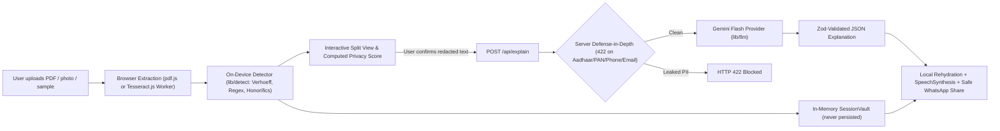

# Samjho

Samjho helps people understand official paperwork — bank loan notices, electricity bills, rental agreements, and government letters — in their own language (`English`, `हिन्दी`, `ಕನ್ನಡ`, `தமிழ்`, `తెలుగు`).

Personal identifiers are detected and redacted **on the user's device in the browser** before any text is sent to an AI model. The plain-language explanation is returned with bracketed tokens (`[PERSON_01]`, `[AADHAAR_01]`, `[ACCOUNT_01]`) and restored locally from an in-memory session vault.

---

## Architecture



---

## Privacy & Threat Model

**Honest guarantee:** _Personal identifiers never leave your device._ Redacted text (containing bracketed placeholders alongside dates, rupee amounts, and clause text) **is** sent to the server and LLM to generate the explanation — Samjho never claims "nothing leaves your device."

### What is protected

- **Aadhaar numbers:** 12 digits starting `2–9`, validated with the Verhoeff $D_5$ checksum (spaces and hyphens tolerated).
- **PAN numbers:** `[A-Z]{5}[0-9]{4}[A-Z]` restricted to valid 4th-character entity codes (`P, C, F, H, A, T, B, L, J, G`).
- **Indian mobile numbers:** `+91` / `91` / `0` prefixes and 10 digits starting `6–9`.
- **Email addresses, UPI handles, IFSC codes, Indian passport numbers.**
- **Dates of birth:** Only dates anchored to DOB labels (`DOB`, `Date of Birth`), leaving bill dates and payment deadlines intact so the explanation remains accurate.
- **Account / Consumer / Loan / Application numbers:** Keyword-anchored alphanumeric IDs.
- **Postal addresses:** Labeled address lines or lines ending in 6-digit Indian PIN codes.
- **Person names:** Heuristic detection via labeled fields (`Consumer Name:`, `Borrower:`), salutations, and Indian/English honorifics (`Shri`, `Smt.`, `Mr.`, `Ms.`, `Dr.`), plus click-to-toggle on any word in the original text.
- **Defense in depth:** `/api/explain` re-runs `lib/detect` on every inbound request and returns **HTTP 422** if an unredacted Aadhaar, PAN, phone number, or email is present. Request bodies are never logged.
- **Ephemeral memory vault:** `SessionVault` lives strictly in JavaScript memory (no `localStorage`, no `sessionStorage`, no cookies, no analytics) and is cleared on **Clear session** and `beforeunload`/`pagehide`.
- **Safe WhatsApp share:** `wa.me` share links contain only document type, scrubbed summary, amounts, and next steps — never vault values or placeholder tokens.

### Known limitations (what is NOT guaranteed)

- **Heuristic name detection:** Unusual names without labels or honorifics, or regional spellings outside standard Latin capitalization, may be missed. Users should inspect the split view and click any missed word to redact it manually before confirming.
- **OCR accuracy:** Skewed, blurry, shadowed, or low-contrast camera photos can misread digits (breaking Verhoeff Aadhaar checks or PAN patterns). Samjho prompts the user to retake unclear photos.
- **Quasi-identifiers:** Monetary amounts, dates, organization names, and rare clauses remain in the redacted text so the model can explain deadlines and sums. Under extreme adversarial linkability, unique combinations of dates/amounts could indirectly identify a document.
- **Browser speech voices:** Audio playback uses the Web `SpeechSynthesis` API; availability of Hindi, Kannada, Tamil, or Telugu voices depends on the user's OS and browser voice packs. Samjho checks available voices per language and degrades gracefully when a voice is absent.

---

## Sample Documents & Pre-Generated Responses

To ensure the live demo remains reliable even under API rate limits, the four built-in sample documents (`public/samples/` — 3 PDFs and 1 synthetic PNG photo generated by `scripts/generate-samples.ts` with valid Verhoeff Aadhaar checksums and fictional identities) are paired with pre-generated, schema-validated responses in `fixtures/sample-responses.json`.

- Loading any sample still runs the **real client-side PDF.js or Tesseract.js OCR extraction**, **real in-browser detection/redaction**, and **real computed privacy score**.
- Unmodified samples display a `sample, pre-generated` tag and offer a **Run live API instead** action.
- Modifying any redaction on a sample or uploading any user file **always hits the live `POST /api/explain` route**.

---

## Local Setup & Commands

### Prerequisites

- Node.js 20+ (tested on Node 24)
- A Google Gemini API key (`GEMINI_API_KEY`) for live uploads

### Environment variables

Copy `.env.example` to `.env.local`:

```bash
GEMINI_API_KEY=your_key_here
GEMINI_MODEL=gemini-3.8-flash
```

### Run locally

```bash
npm install
npm run dev
```

Open `http://localhost:3000`.

### Scripts

- `npm test` — Run all Vitest unit, Verhoeff, round-trip vault, fixture redaction, and API 422 guard tests
- `npm run typecheck` — Run strict TypeScript check (`tsc --noEmit`)
- `npm run lint` — Run ESLint
- `npm run build` — Copy `pdf.worker.min.mjs` and build production Next.js app
- `npm run generate:samples` — Regenerate synthetic sample PDFs, PNG, and validated sample fixtures
